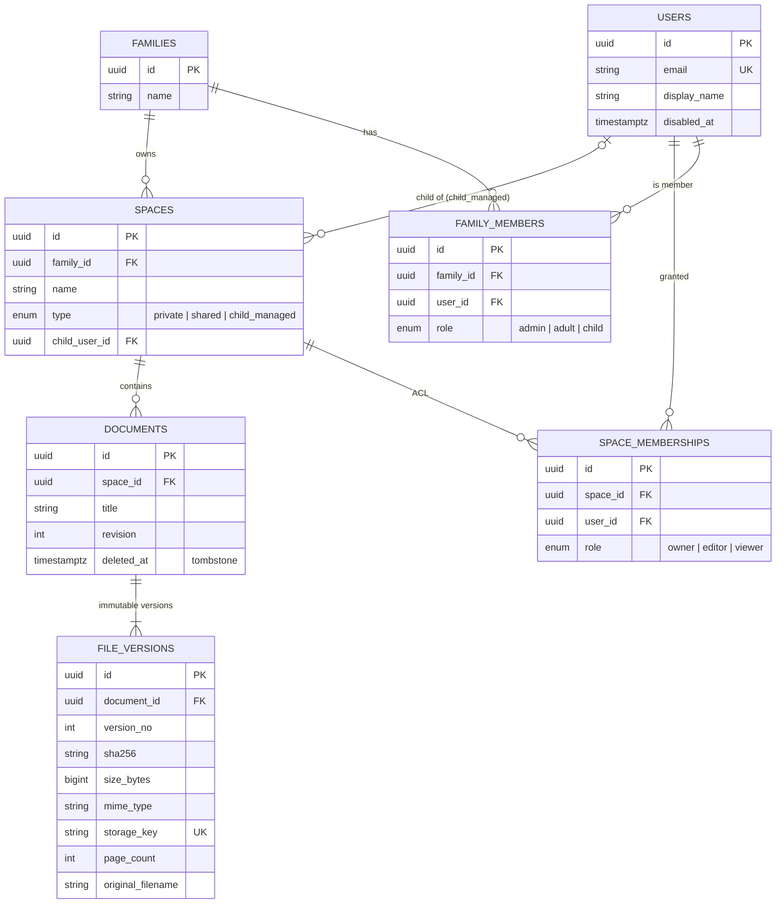

# Data model (server metadata)

Status: implemented in `backend/src/paperless_api/db/models.py`, migrations `0001`–`0002`.
The server stores **metadata only**. Document bytes live in (encrypted) blob storage and are
referenced by an opaque `storage_key`.



All tables except `file_versions` also carry `created_at` / `updated_at`.

## Decisions

| Topic | Decision | Why |
|---|---|---|
| Primary keys | UUIDv4, generated by the creator (device or server) | Offline devices must create stable IDs before sync (see ARCHITECTURE). Revisit UUIDv7 once the minimum Python is 3.14 (`uuid.uuid7`) for better index locality. |
| Timestamps | `timestamptz`, always UTC, naive datetimes rejected (`UTCDateTime` type) | One time zone in storage; SQLite and PostgreSQL behave the same. |
| Enums | `VARCHAR` + `CHECK` constraint (not native PG enums) | Portable to SQLite, adding a value is a simple migration. |
| Deletes | `documents.deleted_at` tombstone; `file_versions` and `documents` use `ON DELETE RESTRICT` | Sync needs tombstones; a space with documents can't be dropped by accident. |
| File versions | Insert-only, `(document_id, version_no)` unique | Original files stay immutable (T5). |
| Concurrency | `documents.revision` (>= 1) | Basis for conflict detection in the sync protocol (Phase 4). |
| Duplicates | `file_versions.sha256` indexed (hex, 64 chars, checked) | Duplicate detection on import (T5). Note: the hash of plaintext is metadata that can reveal "same file" across users; review in the threat model. |
| Constraint names | Deterministic naming convention in `db/base.py` | Stable, reviewable migrations across databases. |

## Migrations

```bash
cd backend
alembic upgrade head          # apply
alembic downgrade -1          # roll back one step
alembic revision --autogenerate -m "describe change"   # then review the generated file!
```

`DATABASE_URL` decides the target (defaults to a local SQLite file `paperless-dev.db`).
`tests/test_db.py` checks upgrade → downgrade → upgrade and fails if models and migrations
drift apart. CI runs these tests against both SQLite and PostgreSQL 16.
